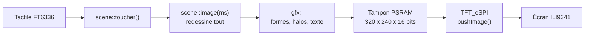

# Esp32-gfx-moteur-graphique

Moteur graphique léger pour **ESP32-S3** et écran **ILI9341 320 × 240** (carte ES3C28P) : formes lissées, transparence, halos lumineux, texte avec accents, animations fluides et tactile, **sans LVGL**. C'est le moteur qui dessine toutes les animations de la console du projet [« vitesse de la lumière »](https://github.com/Edunts5962/Esp32-vitesse-de-la-lumi-re-).


Moteur graphique, vitrine, simulateur et tutoriels développés par **Claude**, l'IA d'Anthropic.

---

## Sommaire

1. [Ce que contient le dépôt](#1-ce-que-contient-le-dépôt)
2. [Le principe en 30 secondes](#2-le-principe-en-30-secondes)
3. [Matériel et logiciels](#3-matériel-et-logiciels)
4. [Lancer la vitrine sur la carte](#4-lancer-la-vitrine-sur-la-carte)
5. [Lancer la vitrine sur PC](#5-lancer-la-vitrine-sur-pc)
6. [Les 9 pages de la vitrine](#6-les-9-pages-de-la-vitrine)
7. [L'API en un coup d'œil](#7-lapi-en-un-coup-dœil)
8. [Utiliser le moteur dans votre projet](#8-utiliser-le-moteur-dans-votre-projet)
9. [Licence et crédits](#9-licence-et-crédits)

---

## 1. Ce que contient le dépôt

```
Esp32-gfx-moteur-graphique/
├── exemples/demo_gfx/          ← la vitrine : croquis Arduino complet
│   ├── demo_gfx.ino               matériel : écran (TFT_eSPI), double tampon PSRAM, tactile
│   ├── scene.cpp/.h               les 9 pages animées (aucun #include Arduino)
│   ├── gfx.cpp/.h                 LE MOTEUR DE DESSIN (~450 lignes, sans dépendance)
│   ├── polices.cpp/.h             police Inter lissée, 6 tailles, avec accents
│   ├── ft6336_touch.cpp/.h        pilote de l'écran tactile
│   ├── sim_demo.cpp               simulateur PC (même scene.cpp que la carte)
│   ├── ppm_vers_png.py            captures PNG et GIF animé
│   └── images/                    captures produites par le simulateur
├── docs/
│   ├── TUTO_GRAPHISME.md          tutoriel complet (principe, API, animations, tactile…)
│   ├── atelier_gfx.html           le même tutoriel en page interactive
│   └── atelier_gfx_src/           sources de la page interactive (portage JavaScript du moteur)
└── outils/generer_polices.py   régénère polices.cpp (ajouter des caractères ou des tailles)
```

**Pour apprendre**, deux formats au choix :

- [`docs/TUTO_GRAPHISME.md`](docs/TUTO_GRAPHISME.md) : à lire directement sur GitHub.
- `docs/atelier_gfx.html` : à **télécharger puis ouvrir dans un navigateur**. Les écrans y tournent en direct (le moteur est porté en JavaScript, rendu identique au pixel près), chaque fonction a des curseurs de réglage et son code C++ généré, et le tutoriel se suit en 12 étapes.

---

## 2. Le principe en 30 secondes

Le programme ne dessine jamais directement sur l'écran. Il calcule une image complète dans un tableau de 320 × 240 pixels en RGB565 (153 600 octets en PSRAM), puis l'envoie d'un bloc avec `tft.pushImage()`. Avec **deux tampons**, le cœur 0 envoie une image pendant que le cœur 1 dessine la suivante.



Dessiner en mémoire permet la transparence, les bords lissés et l'absence de scintillement. Comme `gfx` et `scene` n'utilisent pas Arduino, le même code compile aussi sur PC.

---

## 3. Matériel et logiciels

| Élément | Détail |
|---|---|
| Carte | **ES3C28P** : ESP32-S3, 8 Mo de PSRAM, écran 2,8" ILI9341 320 × 240, tactile FT6336 |
| Arduino IDE | paquet **esp32 3.x**, carte « ESP32S3 Dev Module », PSRAM « OPI PSRAM », Flash 16 Mo |
| Bibliothèque | **TFT_eSPI**, configurée pour l'ILI9341 de la carte (`User_Setup.h` : `ILI9341_DRIVER`, broches SPI de la carte, `USE_HSPI_PORT`, `SPI_FREQUENCY` à 40 MHz ou plus) |
| Sur PC (facultatif) | un compilateur C++17 (`g++`) et Python 3 avec Pillow |

---

## 4. Lancer la vitrine sur la carte

1. Ouvrir `exemples/demo_gfx/demo_gfx.ino` dans l'IDE Arduino.
2. Vérifier les réglages ci-dessus, en particulier **PSRAM « OPI PSRAM »**.
3. Téléverser.
4. Au tout premier démarrage, toucher les 3 croix d'étalonnage (étape sautée si la console « Lumière » ou NES a déjà été installée sur la carte).

Navigation : flèches ‹ › en bas, balayage horizontal, ou toucher le milieu de la barre du bas pour le mode **AUTO** (une page toutes les 8 s). Le nombre d'images par seconde s'affiche en haut à droite.

---

## 5. Lancer la vitrine sur PC

```bash
cd exemples/demo_gfx
g++ -std=c++17 -O2 -I. sim_demo.cpp scene.cpp gfx.cpp polices.cpp -o sim_demo
mkdir -p sortie && ./sim_demo sortie
python3 ppm_vers_png.py sortie        # captures PNG + vitrine.gif
```

Le simulateur rejoue un scénario tactile (appuis, glissements) et enregistre les images : pratique pour mettre au point une mise en page sans téléverser.

---

## 6. Les 9 pages de la vitrine

| | | |
|---|---|---|
|  **1 Primitives** |  **2 Transparence** |  **3 Mouvement** |
|  **4 Arcs et jauges** |  **5 Texte** |  **6 Courbes** |
|  **7 Particules** |  **8 Tactile** |  **9 Découpe** |

| Page | Ce qu'elle montre |
|---|---|
| 1 Primitives | rect, dégradés, rect_arrondi, disque, anneau, triangle, trait, pointillés, arc, halo, pixel, texte |
| 2 Transparence | mélange alpha, lumière additive, rampe d'opacité |
| 3 Mouvement | linéaire, sortie(), lisse(), rebond(), ressort, approche() |
| 4 Arcs et jauges | chargement, anneau de progression, cadran à aiguille, barres |
| 5 Texte | les 6 polices, accents et symboles, machine à écrire, compteur |
| 6 Courbes | oscilloscope (signal + écho), histogramme, droite de régression |
| 7 Particules | fontaine, comète, explosion au toucher |
| 8 Tactile | curseur à inertie, bouton, interrupteur, ondes |
| 9 Découpe | bandeau défilant, barre de progression, révélation, voile |

---

## 7. L'API en un coup d'œil

Tout est dans l'espace de noms `gfx`. Origine en haut à gauche, y vers le bas, `a` = opacité 0–255, angles en radians.

| Famille | Fonctions |
|---|---|
| Tampon et couleurs | `init`, `fb`, `rgb`, `melange`, `copier` |
| Découpe | `decoupe`, `sans_decoupe` |
| Pixels | `pixel`, `pixel_ajout` (lumière additive) |
| Rectangles | `rect`, `degrade_v`, `degrade_h`, `rect_arrondi`, `rect_arrondi_degrade`, `contour_arrondi` |
| Formes lissées | `disque`, `anneau`, `arc`, `trait`, `trait_pointille`, `triangle` |
| Lumière | `halo` |
| Texte | `texte`, `largeur_texte`, `hauteur`, polices `POLICE_11` à `POLICE_40` |

```cpp
gfx::degrade_v(0, 0, 320, 240, gfx::rgb(4, 6, 18), gfx::rgb(16, 12, 42));   // fond
float x = 160 + 120 * sinf(t);                                              // position = f(temps)
gfx::halo(x, 120, 24, CYAN, 160);                                           // lueur
gfx::disque(x, 120, 5, TEXTE);
gfx::texte(160, 200, "Bonjour", POLICE_16, TEXTE, 255, gfx::CENTRE);
```

Le détail de chaque fonction, avec exemples, est dans le [tutoriel](docs/TUTO_GRAPHISME.md#6-référence-complète-de-lapi-gfx).

---

## 8. Utiliser le moteur dans votre projet

1. Copier le dossier `exemples/demo_gfx`, et renommer le `.ino` comme le dossier (règle de l'IDE Arduino).
2. Garder sans y toucher `gfx.*`, `polices.*`, `ft6336_touch.*`, ainsi que l'envoi d'image et le tactile du `.ino`.
3. Remplacer les pages de `scene.cpp` par vos écrans : une fonction de dessin par écran, appelée depuis `scene::image()`.
4. Garder `scene.cpp` sans `#include <Arduino.h>` pour continuer à profiter du simulateur PC.

La section 15 du [tutoriel](docs/TUTO_GRAPHISME.md#15-réutiliser-le-moteur-dans-un-nouveau-projet) détaille la démarche, y compris le partage du bus I²C avec le codec audio ES8311.

---

## 9. Licence et crédits

- Code : licence MIT (voir `LICENSE`).
- Moteur graphique `gfx`, vitrine `demo_gfx`, simulateur PC et tutoriels : développés par **Claude**, l'IA d'Anthropic.
- Police **Inter**, de Rasmus Andersson, sous licence SIL Open Font License 1.1.
- Projet d'origine : [Esp32-vitesse-de-la-lumi-re-](https://github.com/Edunts5962/Esp32-vitesse-de-la-lumi-re-).
