# Tutoriel : le moteur graphique animé (gfx) de la console « Lumière »

Ce document explique **comment toutes les animations de la console sont dessinées** (projet d'origine : [Esp32-vitesse-de-la-lumi-re-](https://github.com/Edunts5962/Esp32-vitesse-de-la-lumi-re-)) sur l'écran 2,8" de la carte ES3C28P, quelles bibliothèques sont utilisées, et comment **réutiliser le moteur** (`gfx.cpp`), l'interface animée et le simulateur PC dans un nouveau projet (par exemple « vitesse du son »).

Une vitrine complète, avec un exemple pour chaque possibilité, se trouve dans [`exemples/demo_gfx`](../exemples/demo_gfx) :

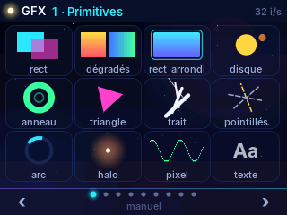

---

## Sommaire

1. [En bref : pas de LVGL, un moteur maison](#1-en-bref--pas-de-lvgl-un-moteur-maison)
2. [Les bibliothèques utilisées](#2-les-bibliothèques-utilisées)
3. [Architecture en couches](#3-architecture-en-couches)
4. [Le principe : dessiner dans une image en mémoire](#4-le-principe--dessiner-dans-une-image-en-mémoire)
5. [Envoyer l'image à l'écran : TFT_eSPI et le double tampon](#5-envoyer-limage-à-lécran--tft_espi-et-le-double-tampon)
6. [Référence complète de l'API gfx](#6-référence-complète-de-lapi-gfx)
7. [Le texte et les polices](#7-le-texte-et-les-polices)
8. [Animer : temps, easing, ressorts, particules](#8-animer--temps-easing-ressorts-particules)
9. [Le tactile FT6336](#9-le-tactile-ft6336)
10. [L'interface : organisation de interface.cpp](#10-linterface--organisation-de-interfacecpp)
11. [plateforme.h : le même code sur la carte et sur PC](#11-plateformeh--le-même-code-sur-la-carte-et-sur-pc)
12. [Le simulateur PC](#12-le-simulateur-pc)
13. [Performances](#13-performances)
14. [La vitrine demo_gfx](#14-la-vitrine-demo_gfx)
15. [Réutiliser le moteur dans un nouveau projet](#15-réutiliser-le-moteur-dans-un-nouveau-projet)
16. [Annexe : et LVGL ?](#16-annexe--et-lvgl-)

---

## 1. En bref : pas de LVGL, un moteur maison

**La console n'utilise pas LVGL.** Toutes les animations sont dessinées par un petit moteur écrit pour ce projet par **Claude**, l'IA d'Anthropic : `gfx.cpp` (~450 lignes de C++ sans aucune dépendance). Les seules traces de LVGL dans le dépôt sont des commentaires `v2.1-BETA-LVGL` dans `ft6336_touch.h/.cpp` : ce pilote tactile vient de la console NES, qui avait une version LVGL. Ici, il est utilisé sans LVGL.

Pourquoi un moteur maison plutôt que LVGL ?

| | gfx (ce projet) | LVGL |
|---|---|---|
| Taille | 1 fichier, ~450 lignes | bibliothèque complète, configuration `lv_conf.h` |
| Modèle | **immédiat** : on redessine toute l'image à chaque fois | **retenu** : on crée des objets (boutons, étiquettes) que LVGL redessine |
| Animations | n'importe quelle formule, à chaque image | animations prévues par LVGL (`lv_anim`) |
| Effets lumineux (halos additifs), particules | naturels | possibles mais plus laborieux |
| Simulateur PC | compile tel quel avec `g++` | possible (SDL), plus lourd |
| Compréhension par des étudiants | tout le code est lisible | « boîte noire » |
| Widgets tout faits (listes, claviers, menus) | à écrire soi-même | fournis |

Pour des écrans de mesure très animés (ondes, photons, révélation de c), le mode immédiat est plus simple : **chaque image est une fonction du temps et de l'état**. LVGL reste un bon choix pour des interfaces riches en formulaires (voir l'[annexe](#16-annexe--et-lvgl-)).

---

## 2. Les bibliothèques utilisées

| Bibliothèque | Où | Ce qu'on en utilise |
|---|---|---|
| **TFT_eSPI** (Bodmer) | `lumiere_console.ino` | **Seulement** l'envoi d'une image complète : `init()`, `setRotation(1)`, `setSwapBytes(true)`, `pushImage(0, 0, 320, 240, tampon)`. Plus `fillScreen()` et `drawString()` pour le message d'erreur « Mémoire insuffisante ». Aucune fonction de dessin de TFT_eSPI n'est utilisée. |
| **Arduino-ESP32 3.x** | `.ino` | `ledcAttachChannel` / `ledcWrite` (rétroéclairage PWM, GPIO 45), `Preferences` (NVS : réglages, étalonnage), `SD_MMC` (CSV), `WiFi` |
| **ESP-IDF** (inclus dans Arduino-ESP32) | `.ino`, pilote tactile | `heap_caps_malloc(..., MALLOC_CAP_SPIRAM)` (tampons en PSRAM), `driver/i2c_master.h` (nouveau pilote I²C, bus partagé tactile + codec), `esp_wifi_ftm_*` (mesure) |
| **FreeRTOS** (inclus) | `.ino` | `xTaskCreatePinnedToCore` (tâche d'envoi d'image sur le cœur 0), sémaphores binaires (double tampon), `portENTER_CRITICAL` (verrou) |
| **ft6336_touch** (maison) | `ft6336_touch.*` | lecture du tactile, étalonnage 3 points sauvé en NVS |
| **gfx** (maison) | `gfx.*` | **tout le dessin** : formes lissées, transparence, halos, texte |
| **Police Inter** (Rasmus Andersson, licence SIL OFL 1.1) | `polices.*` | 6 tailles, converties en tableaux C par `outils/generer_polices.py` |
| **Pillow** (Python) | `outils/generer_polices.py` | rendu des glyphes Inter en 4 bits par pixel |

Réglage TFT_eSPI (`User_Setup.h`, identique à la console NES) : `ILI9341_DRIVER`, broches SPI de la carte, `USE_HSPI_PORT`, `SPI_FREQUENCY` à **40 MHz ou plus** (la fluidité en dépend directement).

---

## 3. Architecture en couches

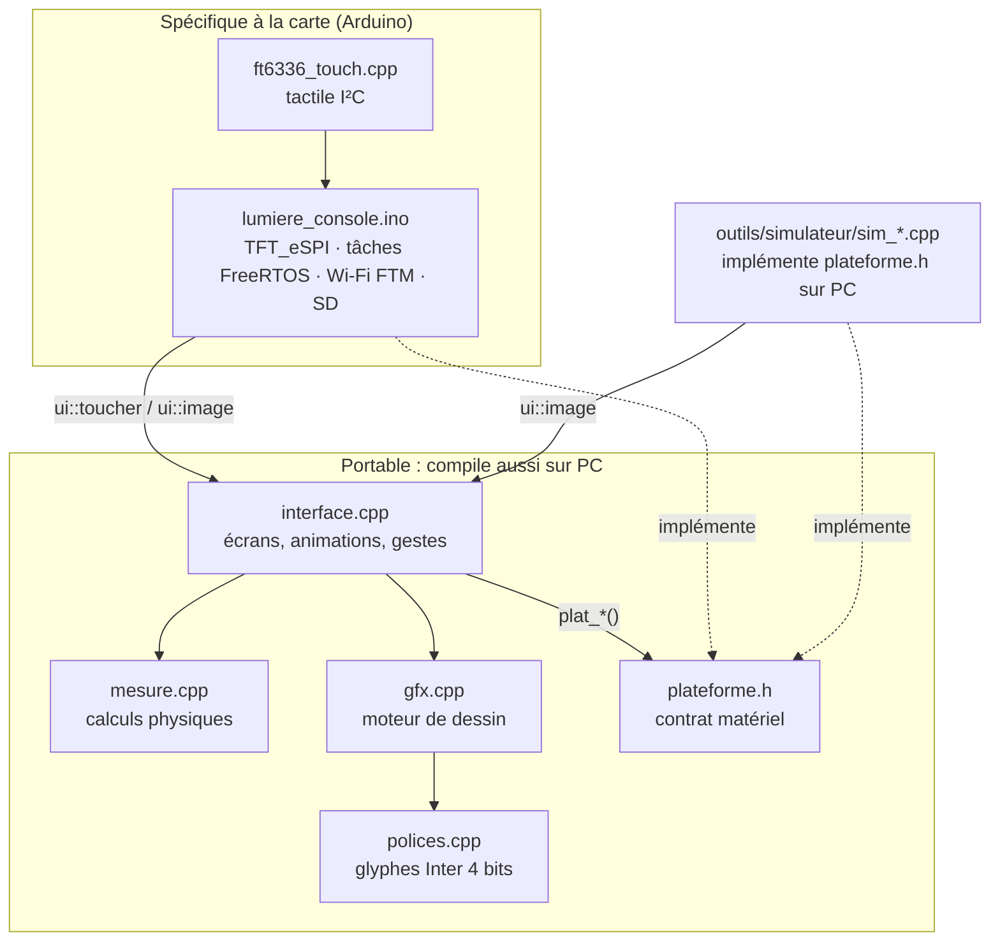

Règle d'or : **`gfx`, `polices`, `interface` et `mesure` n'incluent jamais `Arduino.h`**. Tout ce qui touche au matériel passe par `plateforme.h`. C'est ce qui permet au même code de produire les captures du README sur un PC.

---

## 4. Le principe : dessiner dans une image en mémoire

### Le tampon d'image (framebuffer)

L'écran fait 320 × 240 pixels. Chaque pixel est un entier 16 bits au format **RGB565** :

```
bit  15 14 13 12 11 | 10  9  8  7  6  5 | 4  3  2  1  0
       rouge (5)    |      vert (6)     |   bleu (5)
```

Une image complète pèse 320 × 240 × 2 = **153 600 octets**. Elle est allouée en **PSRAM** (8 Mo sur l'ES3C28P), la mémoire interne de l'ESP32-S3 (~300 Ko utiles) étant trop juste pour plusieurs images.

```cpp
uint16_t *tampon = (uint16_t *)heap_caps_malloc(320 * 240 * 2, MALLOC_CAP_SPIRAM);
gfx::init(tampon);            // gfx dessine désormais dans ce tampon
```

Le pixel (x, y) est `gfx::fb[y * 320 + x]`. Toutes les fonctions de gfx écrivent dans `gfx::fb` ; **rien ne part vers l'écran tant qu'on n'envoie pas l'image**.

### Pourquoi ne pas dessiner directement sur l'écran ?

- **Pas de scintillement** : l'écran reçoit une image finie, jamais un état intermédiaire (fond effacé, texte pas encore écrit…).
- **Transparence** : pour mélanger une couleur avec ce qui est dessous, il faut pouvoir **relire** le pixel. Relire l'ILI9341 par SPI serait très lent ; relire la PSRAM est rapide.
- **Anticrénelage** (bords lisses) : chaque bord de forme est un mélange partiel avec le fond.
- **Portabilité** : un tableau d'entiers existe aussi sur PC.

### Le modèle « immédiat »

À chaque image, on **redessine tout**, du fond vers l'avant :

```cpp
void image(uint32_t ms) {
    fond();             // 1. fond (copie d'un fond pré-calculé)
    ecran_courant();    // 2. contenu de l'onglet
    barre_haut();       // 3. barres fixes
    barre_onglets();
    dessiner_toast();   // 4. messages par-dessus
    if (revel) dessiner_revelation();   // 5. plein écran par-dessus tout
}
```

L'ordre des appels **est** l'ordre de superposition (le dernier dessiné est devant). Il n'y a pas d'objets à créer ni à détruire : un élément visible est simplement un appel de fonction cette image-ci.

---

## 5. Envoyer l'image à l'écran : TFT_eSPI et le double tampon

### Initialisation

```cpp
#include <TFT_eSPI.h>
TFT_eSPI tft = TFT_eSPI();

ledcAttachChannel(45, 2000, 8, 0);   // rétroéclairage : PWM 2 kHz, 8 bits
ledcWrite(45, 204);                   // 80 %
tft.init();
tft.setRotation(1);                   // paysage : 320 x 240
tft.setSwapBytes(true);               // voir ci-dessous
```

**`setSwapBytes(true)`** : l'ILI9341 attend l'octet de poids fort en premier, alors que l'ESP32 (petit-boutiste) stocke l'octet de poids faible en premier. Avec cette option, `pushImage` inverse les octets à l'envoi, et le reste du programme manipule des couleurs RGB565 « normales » (celles que fabrique `gfx::rgb`). Sans elle, les couleurs sont fausses.

### Envoi

```cpp
tft.pushImage(0, 0, 320, 240, tampon);   // ~153 Ko par SPI
```

À 40 MHz, envoyer 153 600 octets prend environ 31 ms : c'est la limite haute d'environ **30 images/s**. À 80 MHz (si l'écran le supporte), environ 15 ms.

### Double tampon sur les deux cœurs

Dessiner une image coûte aussi plusieurs millisecondes. Pour que dessin et envoi se fassent **en même temps**, la console utilise deux tampons et deux cœurs :

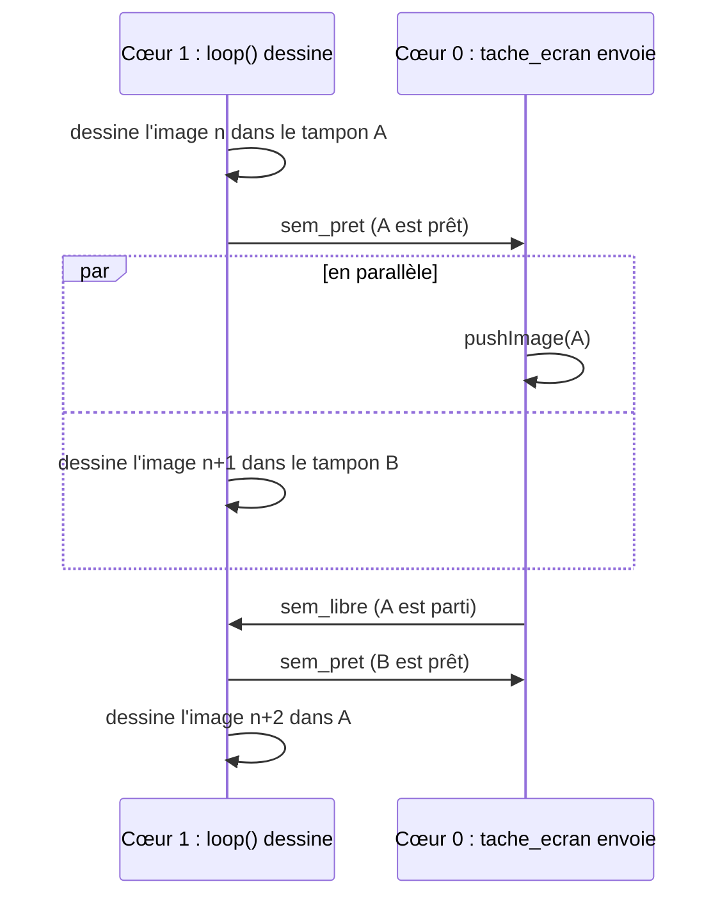

Le code complet (extrait de `lumiere_console.ino`) :

```cpp
static uint16_t *s_tampon[2];
static int s_courant = 0;
static volatile int s_a_envoyer = 0;
static SemaphoreHandle_t s_sem_pret, s_sem_libre;

static void tache_ecran(void *) {                    // cœur 0
    for (;;) {
        xSemaphoreTake(s_sem_pret, portMAX_DELAY);   // attendre une image prête
        tft.pushImage(0, 0, 320, 240, s_tampon[s_a_envoyer]);
        xSemaphoreGive(s_sem_libre);                 // le tampon est libéré
        vTaskDelay(1);
    }
}

void setup() {
    // ... allocations PSRAM ...
    s_sem_pret = xSemaphoreCreateBinary();
    s_sem_libre = xSemaphoreCreateBinary();
    xSemaphoreGive(s_sem_libre);                     // au départ, rien n'est en cours d'envoi
    xTaskCreatePinnedToCore(tache_ecran, "ecran", 4096, NULL, 2, NULL, 0);
}

void loop() {                                        // cœur 1
    gfx::fb = s_tampon[s_courant];                   // dessiner dans le tampon libre
    ui::image(millis());
    xSemaphoreTake(s_sem_libre, portMAX_DELAY);      // l'envoi précédent est fini ?
    s_a_envoyer = s_courant;
    xSemaphoreGive(s_sem_pret);                      // envoie celui-ci
    s_courant ^= 1;                                  // et dessine dans l'autre
}
```

Sans PSRAM, le programme se replie sur **un seul tampon** en mémoire interne (dessin puis envoi, l'un après l'autre) : ça marche, plus lentement.

---

## 6. Référence complète de l'API gfx

Tout est dans l'espace de noms `gfx` (`#include "gfx.h"`). Conventions :

- origine **en haut à gauche**, x vers la droite, **y vers le bas** ;
- les rectangles sont donnés par `(x, y, largeur, hauteur)` ;
- `a` est l'**opacité** 0..255 (255 = opaque, valeur par défaut). En pratique la précision est de 32 niveaux (5 bits) et `a ≥ 250` est traité comme opaque ;
- les formes « lissées » prennent des coordonnées **flottantes** : une forme peut être à x = 10,4 et elle glisse sans à-coups, au sous-pixel près ;
- les **angles** sont en **radians**, 0 = vers la droite, et comme y descend, les angles croissants tournent dans le **sens horaire**.

### 6.1 Constantes, tampon, couleurs

| Fonction | Rôle |
|---|---|
| `const int L = 320, H = 240` | dimensions |
| `uint16_t *fb` | tampon courant (on peut le changer pour dessiner ailleurs) |
| `void init(uint16_t *tampon)` | choisit le tampon et supprime la découpe |
| `constexpr uint16_t rgb(r, g, b)` | couleur RGB565 à partir de 3 octets 0..255 (calculée à la compilation) |
| `uint16_t melange(c0, c1, t)` | interpolation : `t = 0` → `c0`, `t = 255` → `c1` |

```cpp
const uint16_t CYAN = gfx::rgb(40, 228, 255);
uint16_t c = gfx::melange(VIOLET, CYAN, 128);        // couleur à mi-chemin
```

Astuce : `melange` sert à colorer selon une valeur (barres d'histogramme plus claires quand elles sont hautes, interrupteur qui vire au vert…).

Pour dessiner dans **un autre tampon** (par exemple pré-calculer un fond), il suffit de changer `gfx::fb` puis de le remettre :

```cpp
uint16_t *ancien = gfx::fb;
gfx::fb = fond;
dessiner_fond_complet();
gfx::fb = ancien;
```

### 6.2 Découpe (clipping)

| Fonction | Rôle |
|---|---|
| `void decoupe(x0, y0, x1, y1)` | tout dessin hors du rectangle [x0, x1[ × [y0, y1[ est ignoré |
| `void sans_decoupe()` | rétablit l'écran entier |

La découpe est un outil d'animation très puissant :

```cpp
// Barre de progression : un dégradé complet, découpé à la longueur voulue
gfx::decoupe(BX, BY, BX + (int)(BL * progression), BY + BH);
gfx::rect_arrondi_degrade(BX, BY, BL, BH, 12, CYAN, VIOLET);
gfx::sans_decoupe();
```

Autres usages : texte qui défile dans un bandeau, règle graduée qui ne déborde pas de son panneau, révélation d'un titre derrière une ligne lumineuse (page 9 de la vitrine). **Toujours appeler `sans_decoupe()` après.**

### 6.3 Pixels

| Fonction | Rôle |
|---|---|
| `void pixel(x, y, c, a = 255)` | un pixel, mélangé selon `a` |
| `void pixel_ajout(x, y, c, a)` | lumière **additive** : ajoute `c × a/256` au pixel, avec saturation |

`pixel_ajout` éclaircit toujours, quelle que soit la couleur du dessous : c'est ainsi que sont dessinées les étoiles qui scintillent.

### 6.4 Rectangles et dégradés

| Fonction | Rôle |
|---|---|
| `void rect(x, y, l, h, c, a = 255)` | rectangle plein (le plus rapide) |
| `void degrade_v(x, y, l, h, c0, c1, a = 255)` | dégradé vertical, `c0` en haut |
| `void degrade_h(x, y, l, h, c0, c1, a = 255)` | dégradé horizontal, `c0` à gauche |
| `void rect_arrondi(x, y, l, h, r, c, a = 255)` | coins de rayon `r`, lissés |
| `void rect_arrondi_degrade(x, y, l, h, r, c0, c1, a = 255)` | idem avec dégradé vertical |
| `void contour_arrondi(x, y, l, h, r, ep, c, a = 255)` | seulement le bord, épaisseur `ep` (flottante) |

Le « panneau » de verre utilisé partout dans l'interface :

```cpp
static void panneau(int x, int y, int l, int h, uint8_t a = 150) {
    rect_arrondi(x, y, l, h, 12, PANNEAU, a);       // fond semi-transparent
    contour_arrondi(x, y, l, h, 12, 1, BORD, 110);  // liseré fin
}
```

Un `rect` semi-transparent sur toute une zone fait un **voile** : c'est le fondu entre onglets (voir §8.6).

Comment les coins sont lissés : pour chaque pixel des coins, gfx calcule la **distance signée** au bord du rectangle arrondi (`sdf_rect`) ; un pixel à cheval sur le bord reçoit une opacité proportionnelle à la part de sa surface qui est dedans.

### 6.5 Formes lissées

| Fonction | Rôle |
|---|---|
| `void disque(cx, cy, r, c, a = 255)` | disque plein |
| `void anneau(cx, cy, r, ep, c, a = 255)` | cercle d'épaisseur `ep` centré sur le rayon `r` |
| `void arc(cx, cy, r, ep, ang0, ang1, c, a = 255)` | portion d'anneau de `ang0` à `ang1` (radians, `ang1 > ang0`) ; extrémités lissées |
| `void trait(x0, y0, x1, y1, ep, c, a = 255)` | segment d'épaisseur `ep`, bouts arrondis |
| `void trait_pointille(x0, y0, x1, y1, ep, tiret, trou, c, a = 255)` | tirets de longueur `tiret` séparés de `trou` pixels |
| `void triangle(x0, y0, x1, y1, x2, y2, c, a = 255)` | triangle plein (sommets dans n'importe quel ordre) |

```cpp
// Jauge à aiguille (page 4 de la vitrine)
const float D0 = PI * 0.75f, D1 = PI * 2.25f;             // 270°, ouverte en bas
gfx::arc(gx, gy, 32, 5, D0, D1, VERT, 180);
float a = D0 + (D1 - D0) * valeur;                        // valeur 0..1
gfx::trait(gx, gy, gx + cosf(a) * 26, gy + sinf(a) * 26, 2.2f, TEXTE);
gfx::disque(gx, gy, 4, TEXTE);
```

> **Attention, `arc` :** garder les angles proches de 0..2π. Pour un arc qui tourne en continu, utiliser `fmodf(t * vitesse, 2 * PI)` comme angle de départ, sinon après quelques secondes l'arc disparaît (l'angle devient trop grand pour le calcul interne).

Courbes quelconques : enchaîner des petits `trait` (une « polyligne ») :

```cpp
float px = x0, py = f(x0);
for (int x = x0 + 2; x < x1; x += 2) {
    float y = f(x);
    gfx::trait(px, py, x, y, 1.6f, CYAN);
    px = x; py = y;
}
```

C'est ainsi que sont tracées l'onde Wi-Fi de l'écran Mesure et l'oscilloscope de la vitrine.

### 6.6 Halos : la lumière

| Fonction | Rôle |
|---|---|
| `void halo(cx, cy, r, c, intensite)` | tache lumineuse **additive**, intensité décroissante `(1 − d²/r²)²` jusqu'au rayon `r` |

C'est **l'effet signature** de l'interface : photons, logo qui respire, boutons qui brillent, particules. Les halos s'additionnent : trois halos rouge, vert, bleu superposés donnent du blanc (page 2 de la vitrine).

```cpp
gfx::halo(x, y, 16, JAUNE, 140);              // la lueur
gfx::disque(x, y, 3, gfx::rgb(255, 255, 235)); // le cœur, presque blanc
```

Un halo coûte un petit calcul flottant par pixel couvert, donc proportionnel à r² : réserver les très grands halos au fond pré-calculé.

### 6.7 Copie rapide

| Fonction | Rôle |
|---|---|
| `void copier(const uint16_t *source)` | copie une image complète dans `fb` (`memcpy` de 150 Ko) |

Sert à poser le **fond pré-calculé** (dégradé + grands halos) en une seule opération au lieu de le recalculer à chaque image.

### 6.8 Texte

| Fonction | Rôle |
|---|---|
| `int texte(x, y, s, police, c, a = 255, align = GAUCHE)` | écrit la chaîne UTF-8 `s` ; **`y` = haut de la ligne** ; renvoie la largeur en pixels |
| `int largeur_texte(s, police)` | largeur sans dessiner |
| `int hauteur(police)` | interligne de la police |
| `GAUCHE`, `CENTRE`, `DROITE` | alignement par rapport à `x` |

```cpp
gfx::texte(160, 74, "LUMIÈRE", POLICE_30, TEXTE, 255, gfx::CENTRE);
int l = gfx::texte(14, 95, "Temps de vol ", POLICE_11, TEXTE3);
gfx::texte(14 + l, 93, "6,7 ns", POLICE_13, CYAN);      // enchaîner deux styles
gfx::texte(306, 95, "×", POLICE_11, TEXTE2, 255, gfx::DROITE);
```

Le paramètre `a` permet les fondus de texte. Voir la section suivante pour les polices.

---

## 7. Le texte et les polices

### Format

Les polices ne sont pas des fichiers TTF lus à l'exécution : `outils/generer_polices.py` rend chaque caractère avec Pillow et l'enregistre en **4 bits par pixel** (16 niveaux d'opacité) dans `polices.cpp`. À l'affichage, chaque niveau devient l'opacité du pixel : le texte est lissé.

```cpp
struct GlypheAA { uint16_t code;     // code Unicode
                  uint8_t l, h;      // taille du dessin
                  int8_t dx, dy;     // décalage par rapport à la ligne de base
                  uint8_t avance;    // déplacement jusqu'au caractère suivant
                  uint32_t pos; };   // position dans le tableau de bits
struct PoliceAA { const uint8_t *bits; const GlypheAA *glyphes; uint16_t nb;
                  int8_t ascendante, descendante; uint8_t interligne; };
```

Les glyphes sont triés par code : `gfx` les retrouve par recherche dichotomique. Les chaînes C++ sont en UTF-8 (accents écrits directement : `"Réglages"`) ; `gfx` décode l'UTF-8 sur 1 à 3 octets. Un caractère absent de la police est remplacé par `?`.

Les chiffres ont tous la même largeur (« tabulaires ») : un nombre qui change ne fait pas trembler le texte.

### Les 6 polices disponibles

| Police | Fichier Inter | Interligne | Caractères |
|---|---|---|---|
| `POLICE_11` | Inter Medium 11 px | 14 | jeu complet* |
| `POLICE_13` | Inter SemiBold 13 px | 17 | jeu complet* |
| `POLICE_16` | Inter Bold 16 px | 20 | jeu complet* |
| `POLICE_22` | Inter Display Bold 22 px | 28 | jeu complet* |
| `POLICE_30` | Inter Display Bold 30 px | 38 | **majuscules A–Z, È, É, espace seulement** |
| `POLICE_40` | Inter Display Bold 40 px | 49 | **chiffres et `, . - + % × −` seulement** |

\* Jeu complet : ASCII + `àâäçéèêëîïôöùûüÀÂÇÉÈÊÔÙ°±×µμσ·…⁶²√≈→←‹›✓▲▼●−–—`.

Les guillemets « », l'apostrophe typographique ’ et le œ ne sont **pas** inclus : écrire `'` et éviter `«»`, ou les ajouter (ci-dessous).

### Ajouter des caractères ou une taille

1. Télécharger la police Inter (fichiers `.otf`).
2. Modifier `BASE` ou la liste `POLICES` en tête de `outils/generer_polices.py` :
   ```python
   BASE = (... + "«»’œŒ")                                # nouveaux caractères
   POLICES = [ ..., ("POLICE_18", "Inter-Bold.otf", 18, BASE) ]   # nouvelle taille
   ```
3. Régénérer : `python3 outils/generer_polices.py <dossier_otf> exemples/demo_gfx`
4. Chaque police coûte de la mémoire flash : environ 10 à 25 Ko pour le jeu complet.

---

## 8. Animer : temps, easing, ressorts, particules

### 8.1 Le pas de temps

`ui::image(ms)` reçoit l'horloge (`millis()` sur la carte, une horloge simulée sur PC). Au début de chaque image :

```cpp
static float t = 0, dt = 0.033f;
static uint32_t ms_prec = 0;

dt = (ms - ms_prec) / 1000.0f;       // secondes écoulées depuis l'image précédente
if (dt > 0.1f) dt = 0.1f;            // pas de saut après une pause
if (dt < 0.001f) dt = 0.001f;
ms_prec = ms;
t += dt;                             // temps de l'animation, en secondes
```

**Toutes les animations s'expriment en secondes** (`t`, `dt`), jamais en nombre d'images : elles gardent la même vitesse à 15 ou à 40 images/s.

### 8.2 Les fonctions d'animation

Ces petites fonctions (dans `interface.cpp` et `scene.cpp`) font l'essentiel du travail :

```cpp
static inline float sat01(float v) { return v < 0 ? 0 : (v > 1 ? 1 : v); }

// Rapproche v de la cible c ; k = raideur (1/s). Indépendant du nombre d'images/s.
static inline float approche(float v, float c, float k) {
    return v + (c - v) * (1.0f - expf(-k * dt));
}

// Courbe de sortie cubique : démarre vite, freine à l'arrivée (0 -> 1)
static inline float sortie(float x) { x = sat01(x); return 1 - (1-x)*(1-x)*(1-x); }

// « smoothstep » : départ et arrivée en douceur
static inline float lisse(float x) { x = sat01(x); return x * x * (3 - 2 * x); }

// Oscillation 0..1 à la fréquence f (Hz) : respiration, clignotement
static inline float pulse(float f, float ph = 0) {
    return 0.5f + 0.5f * sinf(t * f * 2 * PI + ph);
}
```

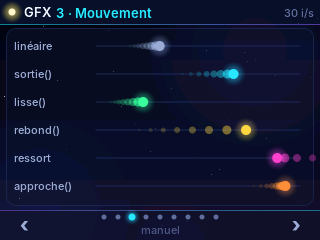

### 8.3 Le patron « valeur affichée → valeur cible »

C'est le cœur de toutes les transitions de l'interface. L'état réel change d'un coup ; ce qui est **affiché** le rattrape en douceur :

```cpp
static int   onglet = 0;          // état réel (change instantanément au toucher)
static float onglet_aff = 0;      // position affichée du surlignage

onglet_aff = approche(onglet_aff, (float)onglet, 14);
int hx = (int)(4 + onglet_aff * 64);
gfx::rect_arrondi_degrade(hx, 207, 56, 31, 10, ...);    // le surlignage glisse
```

Utilisé pour : le surlignage des onglets, la carte B qui se déplace avec la distance, les contrôles à segments, l'aiguille, les barres de l'histogramme, le compteur qui « roule » vers sa valeur, le fondu de couleur d'un interrupteur.

### 8.4 Animations « à durée » : âge et courbe

Pour un événement qui commence à `t0` et dure `D` secondes :

```cpp
float age = t - t0;
float e = sortie(age / 0.6f);                                  // 0 -> 1 en 0,6 s
gfx::texte(14 + (int)(60 * (1 - e)), 30, "TITRE", POLICE_30, TEXTE, (uint8_t)(255 * e));
```

Le titre glisse de 60 px et apparaît en fondu. Le « toast » (message qui descend du haut) suit le même principe avec trois phases : entrée (0,3 s), maintien, sortie (0,4 s).

```cpp
float e = age < 0.3f ? sortie(age / 0.3f) : (age > 2.2f ? 1 - (age - 2.2f) / 0.4f : 1);
int y = (int)(-20 + 50 * e);                                   // descend de -20 à 30
```

### 8.5 Ressort amorti (aiguilles, rebonds)

Quand on veut un léger dépassement puis un retour (effet « physique ») :

```cpp
static float x = 0, v = 0;
v += (cible - x) * 140 * dt;     // force de rappel (raideur)
v *= expf(-7 * dt);              // frottement (amortissement)
x += v * dt;
```

Plus de raideur = plus rapide ; moins d'amortissement = plus d'oscillations.

### 8.6 Fondus et voiles

Un `rect` semi-transparent par-dessus une zone l'estompe. Le fondu d'entrée à chaque changement d'onglet :

```cpp
float ft = (t - onglet_t0) / 0.25f;
if (ft < 1) gfx::rect(0, 26, L, 178, FOND_HAUT, (uint8_t)(230 * (1 - sortie(ft))));
```

### 8.7 Mouvements périodiques

`fmodf(t / periode, 1.0f)` donne une phase 0..1 qui recommence sans fin : photons qui font l'aller-retour, reflet qui balaie un bouton, bandeau défilant.

```cpp
float u = fmodf(t / 1.8f, 1.0f);                // 0..1 toutes les 1,8 s
bool aller = u < 0.5f;
float v = aller ? u * 2 : (u - 0.5f) * 2;
float e = v * v * (3 - 2 * v);                  // lisse
float x = aller ? xA + (xB - xA) * e : xB - (xB - xA) * e;
```

### 8.8 Particules et traînées

Un tableau de structures, mis à jour à chaque image :

```cpp
struct Particule { float x, y, vx, vy, vie, age; uint16_t c; };
static Particule part[160];
static int nb_part = 0;

for (int i = 0; i < nb_part;) {
    Particule &p = part[i];
    p.age += dt;
    if (p.age > p.vie) { p = part[--nb_part]; continue; }   // retrait en O(1)
    p.vy += 120 * dt;                                        // gravité
    p.x += p.vx * dt;  p.y += p.vy * dt;
    float a = 1 - p.age / p.vie;                             // s'éteint en vieillissant
    gfx::halo(p.x, p.y, 5, p.c, (uint8_t)(120 * a));
    gfx::disque(p.x, p.y, 1.4f, p.c, (uint8_t)(255 * a));
    i++;
}
```

**Traînée** : garder les N dernières positions et dessiner des disques de plus en plus petits et transparents (comète de la vitrine, photons de l'écran Mesure).

**Ondes de choc** : un `anneau` dont le rayon grandit avec `sortie(age / D)` et dont l'opacité baisse (arrivée d'un photon, toucher sur l'écran).

### 8.9 Hasard

Un générateur xorshift très léger, identique sur carte et PC (les captures du simulateur sont donc reproductibles) :

```cpp
static uint32_t alea_e = 0x9E3779B9;
static float alea() {           // 0..1
    alea_e ^= alea_e << 13; alea_e ^= alea_e >> 17; alea_e ^= alea_e << 5;
    return (alea_e >> 8) * (1.0f / 16777216.0f);
}
```

---

## 9. Le tactile FT6336

### Le pilote `ft6336_touch`

Le FT6336 est relié en **I²C** (SDA 16, SCL 15, reset 18). Le pilote utilise le nouveau pilote ESP-IDF `i2c_master`, ce qui permet de **partager le bus** avec le codec audio ES8311 (même broches) : important pour un projet son.

| Fonction | Rôle |
|---|---|
| `bool ft6336_touch_init(bus, rst, 320, 240)` | initialise la puce sur un bus `i2c_master` déjà créé |
| `bool ft6336_touch_read(int *x, int *y)` | **lecture étalonnée** en coordonnées écran ; `true` si un doigt est posé |
| `bool ft6336_touch_get_raw(int *x, int *y)` | lecture brute (pendant l'étalonnage) |
| `bool ft6336_touch_set_calibration(...)` | calcule la transformation affine à partir de 3 points (brut, écran) ; `false` si les points sont alignés |
| `void ft6336_touch_save_calibration()` | sauve l'étalonnage en NVS (survit au reflashage) |
| `bool ft6336_touch_load_calibration()` | recharge l'étalonnage ; `false` au tout premier démarrage |
| `void ft6336_touch_map_raw(rx, ry, &x, &y)` | applique l'étalonnage à un point brut déjà lu |
| `ft6336_touch_get_coeffs / set_coeffs(float[6])` | lire / remettre les coefficients (annuler un étalonnage raté) |

L'étalonnage 3 points (dessiné avec gfx) n'est lancé que si aucun n'existe déjà : la console NES, la console Lumière et la vitrine partagent le même enregistrement.

### Des appuis aux gestes : la machine à états

Le pilote donne seulement « doigt posé en (x, y) ou non » à chaque image. `ui::toucher(appui, x, y)` en tire des gestes en comparant avec l'image précédente :

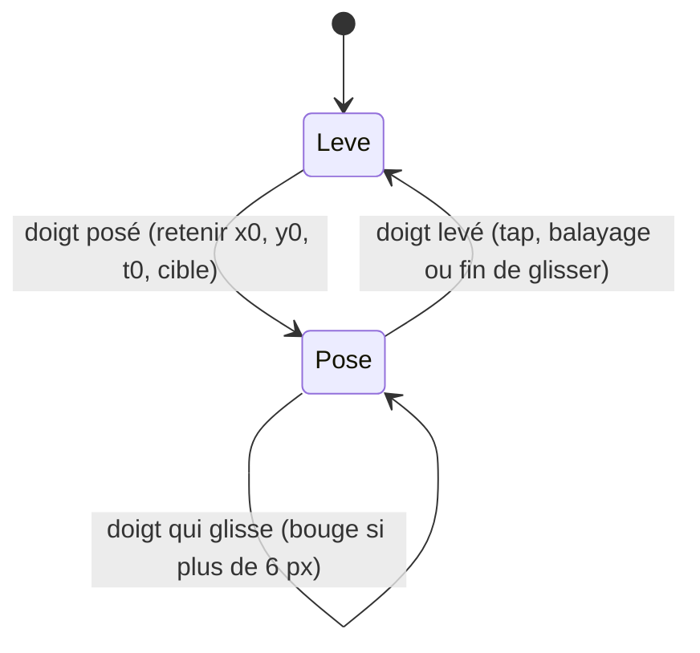

```cpp
void toucher(bool appui, int x, int y) {
    if (appui && !tc_appui) {                 // le doigt se pose
        tc_x0 = tc_x = tc_xp = x;  tc_y0 = tc_y = y;
        tc_t0 = t;  tc_bouge = false;
        tc_cible = dans(x, y, REGLE) ? C_REGLE : C_RIEN;   // que touche-t-on ?
    } else if (appui && tc_appui) {           // il glisse
        if (abs(x - tc_x0) > 6 || abs(y - tc_y0) > 6) tc_bouge = true;
        if (tc_cible == C_REGLE) { /* déplacer la règle de (x - tc_xp) */ }
        tc_xp = x;
    } else if (!appui && tc_appui) {          // il se lève
        if (!tc_bouge && t - tc_t0 < 0.8f) tap(tc_x0, tc_y0);   // appui court = tap
        tc_cible = C_RIEN;
    }
    tc_appui = appui;
}
```

- **Tap** : levé sans avoir bougé de plus de 6 px, en moins de 0,8 s. `tap()` teste ensuite les zones avec `dans(x, y, rx, ry, rl, rh)`.
- **Glisser avec inertie** (règle des distances) : pendant le glissement, on mémorise une vitesse lissée ; au lâcher, la valeur continue sur sa lancée et freine (`v *= expf(-3.5f * dt)`).
- **Balayage** (vitrine) : levé après un déplacement horizontal de plus de 60 px → page suivante ou précédente.
- **Bouton qui s'enfonce** : tant que `tc_cible == C_BOUTON` et que le doigt est dans le bouton, on le dessine plus petit et plus sombre ; l'action a lieu au lâcher.

---

## 10. L'interface : organisation de interface.cpp

```cpp
namespace ui {
void init(uint16_t *fond);               // lit les réglages, pré-calcule le fond
void toucher(bool appui, int x, int y);  // à chaque image
void image(uint32_t ms);                 // dessine une image complète dans gfx::fb
}
```

| Partie | Contenu |
|---|---|
| Palette | ~18 couleurs `static const uint16_t` (fond bleu nuit, panneaux, cyan, jaune…) |
| État | variables `static` : onglet, positions affichées, particules, toast… |
| Outils | `approche`, `sortie`, `pulse`, `alea`, `fmt` (nombres avec virgule), `dans` |
| Fond | `dessiner_fond_complet()` (une fois) + `fond()` (copie + étoiles) |
| Éléments communs | `panneau`, `barre_haut` (logo, badge d'état), `barre_onglets` (icônes dessinées en primitives), `dessiner_toast`, `segments` |
| Un couple par onglet | `ecran_xxx()` dessine, `tap_xxx(x, y)` réagit |
| Plein écran | `dessiner_splash`, `dessiner_revelation` (particules + compteur) |
| Boucle | `image()` : temps, événements de mesure, puis dessin dans l'ordre |

Les icônes des onglets ne sont pas des images : elles sont **dessinées en primitives** (`icone()`), ce qui les rend colorables et animables (l'engrenage de Réglages tourne).

---

## 11. plateforme.h : le même code sur la carte et sur PC

Tout ce dont l'interface a besoin du matériel est déclaré dans `plateforme.h` :

```cpp
uint32_t plat_ms();
void plat_verrou(); void plat_deverrou();
void plat_luminosite(int pct);
void plat_source(int source);
bool plat_carte_a();
bool plat_sd();
void plat_csv(float d, const uint32_t *rtt_ps, const int8_t *rssi, int n);
bool plat_nvs_lire(const char *cle, void *buf, size_t n);
void plat_nvs_ecrire(const char *cle, const void *buf, size_t n);
uint32_t plat_memoire_libre();
```

- **Sur la carte**, `lumiere_console.ino` les implémente (`millis()`, `ledcWrite`, `Preferences`, `SD_MMC`…).
- **Sur PC**, `sim_main.cpp` les implémente avec une horloge simulée et une `std::map` pour la NVS.

Pour un nouveau projet : **garder l'idée, changer la liste**. Un projet audio aura par exemple `plat_emettre_bip()`, `plat_lire_micro(int16_t *buf, int n)`…

---

## 12. Le simulateur PC

Le simulateur compile **le même** `interface.cpp`, `gfx.cpp`, `polices.cpp`, `mesure.cpp`, et remplace le `.ino` par un scénario :

```cpp
static uint16_t fb[320 * 240], fond[320 * 240];

static void image(bool appui = false, int x = 0, int y = 0) {
    g_ms += 33;                       // 30 images/s simulées
    ui::toucher(appui, x, y);
    ui::image(g_ms);
}
static void taper(int x, int y) { image(true, x, y); image(true, x, y); image(false, x, y); }

int main() {
    gfx::init(fb);
    ui::init(fond);
    attendre(1.3f);  capture("00_demarrage");
    taper(288, 222); attendre(0.6f);  capture("02_reglages");
    ...
}
```

Les images sont écrites au format **PPM** (le plus simple qui soit : un en-tête texte puis les octets RGB), en convertissant RGB565 → RGB888 :

```cpp
uint8_t r = (c >> 11) << 3, g = ((c >> 5) & 63) << 2, b = (c & 31) << 3;
r |= r >> 5;  g |= g >> 6;  b |= b >> 5;      // étale sur 0..255
```

Compilation (Linux, macOS, ou Windows avec MinGW / WSL) :

```bash
cd exemples/demo_gfx
g++ -std=c++17 -O2 -I. sim_demo.cpp scene.cpp gfx.cpp polices.cpp -o sim_demo
mkdir -p sortie && ./sim_demo sortie
python3 ppm_vers_png.py sortie        # captures PNG + animation GIF
```

Intérêt : mettre au point une mise en page en quelques secondes sans téléverser, produire les captures et GIF du README, et tester des scénarios reproductibles.

---

## 13. Performances

| Conseil | Pourquoi |
|---|---|
| `SPI_FREQUENCY` ≥ 40 MHz | l'envoi de 150 Ko est le premier facteur limitant |
| Fond pré-calculé + `copier()` | le dégradé et les grands halos du fond coûtent bien plus qu'un `memcpy` |
| Double tampon PSRAM | dessin et envoi en parallèle sur les deux cœurs |
| `rect` plutôt que `rect_arrondi` pour les grandes zones | `rect` n'a aucun calcul par pixel |
| Limiter la taille des halos | coût proportionnel à r² |
| `decoupe()` | les primitives sautent les pixels hors zone avant tout calcul |
| Opaque si possible (`a = 255`) | un pixel opaque est une simple écriture ; transparent = lecture + mélange |
| Mesurer | la vitrine affiche les images/s en haut à droite (l'onglet Réglages de la console aussi) |

Le mélange alpha utilise une astuce classique sur le RGB565 : on écarte les trois canaux dans un entier 32 bits (`0x07E0F81F`) pour les mélanger tous en **une seule multiplication** (fonction `mel` dans `gfx.cpp`).

---

## 14. La vitrine demo_gfx

[`exemples/demo_gfx`](../exemples/demo_gfx) est un projet minimal qui montre **toutes** les possibilités du moteur, page par page. Il sert de banc d'essai et de point de départ.

| Page | Ce qu'elle montre | Fonctions |
|---|---|---|
| 1 Primitives | une case animée par primitive | toutes |
| 2 Transparence | mélange alpha vs lumière additive, rampe d'opacité | `disque(…, a)`, `halo` |
| 3 Mouvement | 6 façons d'aller de A à B, avec traînée | `sortie`, `lisse`, `rebond`, ressort, `approche` |
| 4 Arcs et jauges | chargement, progression %, cadran à aiguille, barres | `arc`, `anneau`, ressort |
| 5 Texte | 6 polices, accents, symboles, machine à écrire, compteur | `texte`, `largeur_texte` |
| 6 Courbes | oscilloscope signal + écho, histogramme, régression qui se trace | polyligne de `trait`, `trait_pointille`, `decoupe` |
| 7 Particules | fontaine, comète, explosion au toucher | tableaux de particules, `halo` |
| 8 Tactile | curseur lancé avec inertie, bouton qui s'enfonce, interrupteur, ondes | `toucher()` |
| 9 Découpe | bandeau défilant, barre de progression, révélation, voile | `decoupe`, `rect(…, a)` |

| | | |
|---|---|---|
| 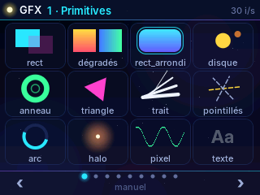 | 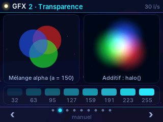 |  |
| 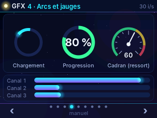 | 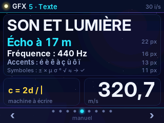 | 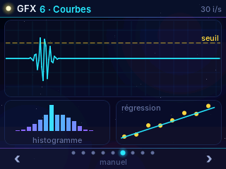 |
| 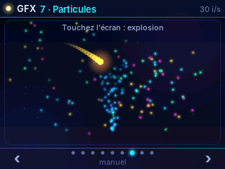 | 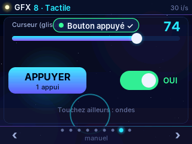 | 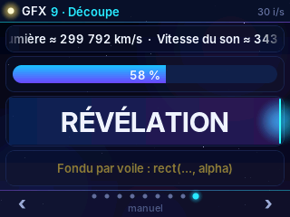 |

Navigation : flèches ‹ › de la barre du bas, balayage horizontal, ou mode **AUTO** (toucher le milieu de la barre) qui change de page toutes les 8 secondes. Sans tactile détecté, la vitrine tourne en AUTO.

Voir [`exemples/demo_gfx/LISEZMOI.md`](../exemples/demo_gfx/LISEZMOI.md) pour la compilation.

---

## 15. Réutiliser le moteur dans un nouveau projet

Exemple : projet « vitesse du son » (écho + effet Doppler) sur la même carte ES3C28P.

1. **Partir de la vitrine** : copier `exemples/demo_gfx` dans un nouveau dossier, renommer `demo_gfx.ino` comme le dossier (règle de l'IDE Arduino).
2. **Garder sans y toucher** : `gfx.*`, `polices.*`, `ft6336_touch.*`, et dans le `.ino` l'envoi d'image (double tampon) et le tactile.
3. **Écrire `scene.cpp`** (ou `interface.cpp`) : une palette, des fonctions `ecran_xxx()` / `tap_xxx()`, et la boucle `image()`. Reprendre `panneau`, `barre_haut`, `barre_onglets`, `dessiner_toast`, `segments` depuis `interface.cpp`.
4. **Définir `plateforme.h`** avec ce que les écrans demandent au matériel (micro, haut-parleur, SD…), l'implémenter dans le `.ino`, puis dans un `sim_main.cpp` (valeurs simulées) pour garder le simulateur PC.
5. **Les calculs physiques** dans un fichier séparé sans Arduino (comme `mesure.cpp`), testable sur PC.
6. **Audio** : le codec ES8311 est sur le même bus I²C que le tactile. Créer **un seul** bus `i2c_master` dans `setup()` et y attacher les deux puces (voir les commentaires de `ft6336_touch.h`).
7. **Mémoire** : 3 images en PSRAM = 450 Ko sur 8 Mo ; il reste beaucoup de place pour des tampons audio.

Squelette minimal d'un écran :

```cpp
#include "gfx.h"
using namespace gfx;

static const uint16_t CYAN = rgb(40, 228, 255), TEXTE = rgb(236, 242, 255);
static float t = 0, dt = 0.033f;
static uint32_t ms_prec = 0;

void mon_image(uint32_t ms) {
    if (!ms_prec) ms_prec = ms;
    dt = (ms - ms_prec) / 1000.0f;  if (dt > 0.1f) dt = 0.1f;
    ms_prec = ms;  t += dt;

    degrade_v(0, 0, L, H, rgb(4, 6, 18), rgb(16, 12, 42));      // fond
    float x = 160 + 120 * sinf(t);                                // un point qui oscille
    halo(x, 120, 24, CYAN, 160);
    disque(x, 120, 5, TEXTE);
    texte(160, 200, "Bonjour", POLICE_16, TEXTE, 255, CENTRE);
}
```

---

## 16. Annexe : et LVGL ?

LVGL n'est pas utilisé dans ce dépôt. Si un futur projet a besoin de nombreux widgets standards (listes déroulantes, clavier virtuel, tableaux), LVGL peut se brancher sur **les mêmes briques** : TFT_eSPI pour l'envoi et `ft6336_touch_read` pour le doigt. Esquisse pour **LVGL 9** (non testée sur cette carte, à adapter) :

```cpp
#include <lvgl.h>
#include <TFT_eSPI.h>
#include "ft6336_touch.h"

TFT_eSPI tft;
static uint16_t *buf1, *buf2;      // tampons partiels, par ex. 320 x 40 pixels

static void flush_cb(lv_display_t *disp, const lv_area_t *a, uint8_t *px) {
    tft.pushImage(a->x1, a->y1, a->x2 - a->x1 + 1, a->y2 - a->y1 + 1, (uint16_t *)px);
    lv_display_flush_ready(disp);                       // zone envoyée
}

static void touch_cb(lv_indev_t *, lv_indev_data_t *d) {
    int x, y;
    if (ft6336_touch_read(&x, &y)) { d->point.x = x; d->point.y = y; d->state = LV_INDEV_STATE_PRESSED; }
    else d->state = LV_INDEV_STATE_RELEASED;
}

void setup() {
    tft.init(); tft.setRotation(1); tft.setSwapBytes(true);
    // ... init I²C + ft6336_touch_init + load_calibration, comme dans le .ino ...
    lv_init();
    lv_tick_set_cb([]() -> uint32_t { return millis(); });
    lv_display_t *disp = lv_display_create(320, 240);
    size_t n = 320 * 40 * 2;
    buf1 = (uint16_t *)heap_caps_malloc(n, MALLOC_CAP_DMA);
    buf2 = (uint16_t *)heap_caps_malloc(n, MALLOC_CAP_DMA);
    lv_display_set_buffers(disp, buf1, buf2, n, LV_DISPLAY_RENDER_MODE_PARTIAL);
    lv_display_set_flush_cb(disp, flush_cb);
    lv_indev_t *ind = lv_indev_create();
    lv_indev_set_type(ind, LV_INDEV_TYPE_POINTER);
    lv_indev_set_read_cb(ind, touch_cb);

    lv_obj_t *btn = lv_button_create(lv_screen_active());
    lv_obj_center(btn);
    lv_label_set_text(lv_label_create(btn), "MESURER");
}

void loop() { lv_timer_handler(); delay(5); }
```

Points d'attention : `lv_conf.h` (copier `lv_conf_template.h`, mettre `LV_COLOR_DEPTH 16`), et l'ordre des octets (avec `setSwapBytes(true)` ci-dessus, ne pas activer en plus l'inversion côté LVGL). Les deux approches peuvent même coexister : LVGL pour un écran de réglages, gfx pour une scène animée dessinée dans un `lv_canvas`… mais pour des projets pédagogiques comme celui-ci, le moteur maison reste plus simple à lire et à modifier.
